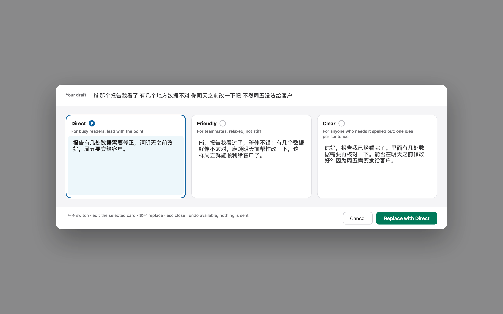

# Be Nice

Rewrite your Slack drafts into clearer, kinder messages — pick from three versions, replace in place, undo anytime.



*(Synthetic sample draft.)*

A macOS menu-bar app for the Slack desktop app. You write a draft as usual; Be Nice rewrites the whole draft (no need to select anything) into three versions: by default **Polite**, **Shorter** and **Friendly**. You pick one, optionally edit it, confirm, and it replaces your draft in Slack's message box. A visible **Undo** button restores your original text. Be Nice never sends a message for you.

## Status

Early preview (v0.2.0).

- Verified in real Slack: channels, threads and direct messages with plain-text drafts, including Chinese drafts.
- Drafts with rich content (links, mentions, lists, formatting, emoji) are copy-only: Be Nice never replaces them. Press ⌘↩ (or **Copy rewrite**) to copy the result, go back to Slack, then ⌘A and ⌘V to paste it over your draft. Paragraph layout (single lines, Shift+Return lines, paragraphs separated by one blank line) is kept on Replace and Undo; if the layout can't be read safely, Be Nice offers copy only.
- Slack only: other apps are not supported. Real Chinese IME composition, emoji, and same-name conversations are not yet verified.
- If Be Nice can't safely confirm the target message box, it refuses to replace and offers copy only.

## Install

1. Download `BeNice-0.2.0-macos.zip` from [Releases](https://github.com/mfang0126/be-nice/releases).
2. Unzip, move **Be Nice.app** to `/Applications`.
3. The app isn't notarized (no Apple Developer ID). The first time, **right-click → Open** and confirm.
4. Grant **Accessibility** access in System Settings → Privacy & Security when asked. It is needed to read and replace the text in Slack's message box.

Built for macOS 13 or later; so far tested on macOS 26 only.

## Setup

Open **Settings** from the menu-bar icon and pick a model source. **Nothing is sent until you choose a provider and click Save.**

- **GitHub Copilot**: uses the GitHub login already on your Mac. Install the [GitHub CLI](https://cli.github.com) and run `gh auth login` in Terminal once; Be Nice never signs you in or out and never stores the token. Pick a model from the list (the fast `gpt-4o-mini` is preselected when your plan has it). Copilot's chat API is not publicly documented by GitHub, so this may change.
- **Custom**: any OpenAI-compatible endpoint (`/v1/chat/completions`): base URL, API key (stored in your Keychain) and model name. Ollama or LM Studio on your own machine work too.

Click **Test** to check it works (with Copilot, click **Load models** first to read the model list from your GitHub login). **Privacy:** with Copilot or a remote endpoint, your draft text is sent to that provider. Be Nice has no server of its own and bundles no model.

You can also change the three rewrite styles in Settings: each has a name and one line of instruction, `Presets` fills a row as a starting point, and `Restore default styles` brings the original three back (your model and API key stay as they are). In the rewrite window, clicking a style name tries another style for that one rewrite only.

## Use

1. Type a draft in Slack.
2. Click the **Rewrite** button above Slack's message box, or press **⌃⌥⌘Space**.
3. Choose a version, edit if you like. To change one version, click its style name, or type how it should change ("more polite") and press Return. Then confirm to replace the draft.
4. Click **Undo** to get your original back.

## Build from source

```sh
sh mac-app/scripts/build-release.sh   # builds "Be Nice.app" and a zip in mac-app/.build/release-dist/
sh mac-app/scripts/run-tests.sh       # compile + self-tests
```

Requires Xcode command-line tools with Swift 6. Contributors: see [AGENTS.md](AGENTS.md) and [mac-app/README.md](mac-app/README.md).

## Limitations

- Slack desktop only, macOS only.
- Two conversations with the same name can't be told apart when checking the target.
- No personal style learning yet.

## License

[MIT](LICENSE). Be Nice is an independent project and is not affiliated with, endorsed by, or sponsored by Slack Technologies.
